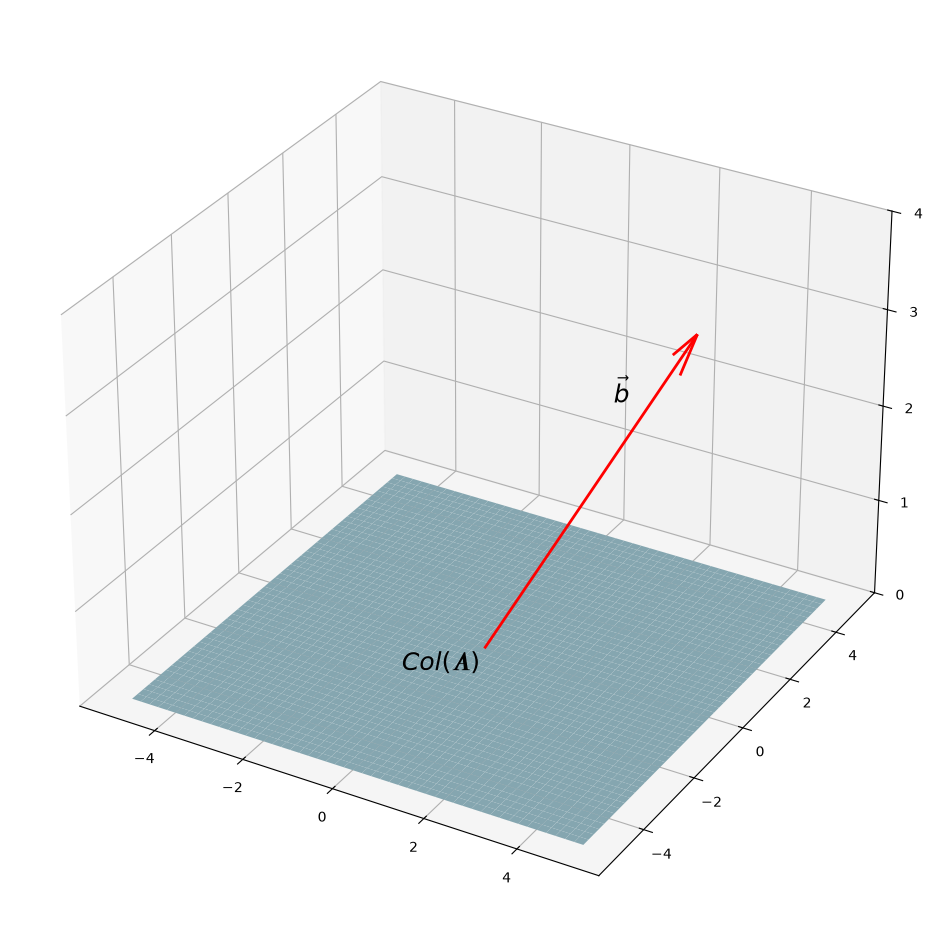
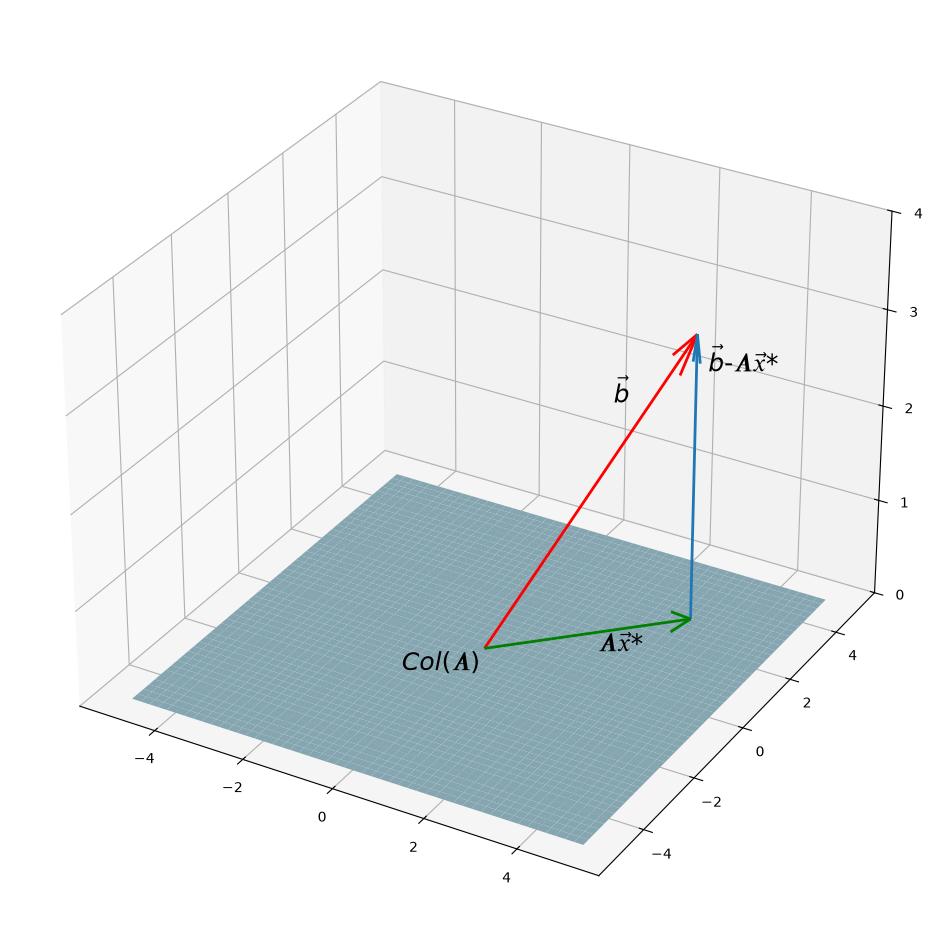
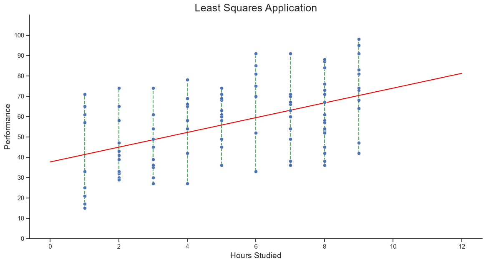
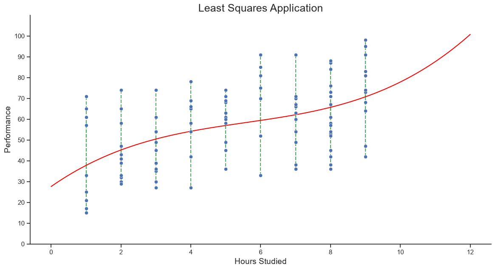
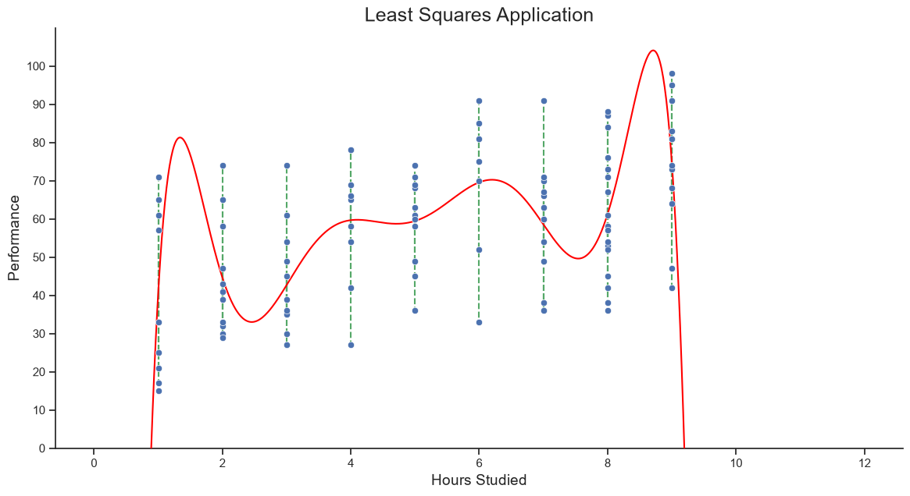

<div align="center">

# Least Squares

*Finding the closest possible solution when an exact one does not exist.*

</div>

---

## What is Least Squares?

For a linear system

$$
A\mathbf{x}=\mathbf{b},
$$

an exact solution may not exist because $\mathbf{b}$ is not in the column space of $A$, written $\operatorname{Col}(A)$. Least squares finds the vector $\mathbf{x}^*$ whose output $A\mathbf{x}^*$ is **as close as possible** to $\mathbf{b}$:

$$
\boxed{\displaystyle
\mathbf{x}^*=\underset{\mathbf{x}}{\operatorname{arg\,min}}\;\lVert A\mathbf{x}-\mathbf{b}\rVert^2}
$$

Geometrically, $A\mathbf{x}^*$ is the orthogonal projection of $\mathbf{b}$ onto $\operatorname{Col}(A)$. The difference between them is the residual.

<div align="center">




| No exact solution | Least-squares solution |
| :---: | :---: |
| $\mathbf{b}$ lies outside $\operatorname{Col}(A)$. | $A\mathbf{x}^*$ is the closest point in $\operatorname{Col}(A)$ to $\mathbf{b}$. |

</div>

---

## Why the Normal Equations Work

Let the residual be

$$
\mathbf{r}=\mathbf{b}-A\mathbf{x}^*.
$$

At the closest point, the residual is perpendicular to every vector in $\operatorname{Col}(A)$. Since the columns of $A$ span this space,

$$
\mathbf{r}\perp\operatorname{Col}(A)
\quad\Longrightarrow\quad
A^{\mathsf T}\mathbf{r}=\mathbf{0}.
$$

Substituting $\mathbf{r}=\mathbf{b}-A\mathbf{x}^*$ gives

$$
A^{\mathsf T}(\mathbf{b}-A\mathbf{x}^*)=\mathbf{0}
$$

$$
A^{\mathsf T}\mathbf{b}-A^{\mathsf T}A\mathbf{x}^*=\mathbf{0}
$$

$$
\boxed{A^{\mathsf T}A\mathbf{x}^*=A^{\mathsf T}\mathbf{b}}
$$

These are the **normal equations**. Solving them gives the least-squares solution.

---

## Worked Example

Consider

$$
A=
\begin{bmatrix}
1 & 1\\
2 & 1\\
3 & 1
\end{bmatrix},
\qquad
\mathbf{b}=
\begin{bmatrix}
1\\
2\\
2
\end{bmatrix}.
$$

First, form the two sides of the normal equations:

$$
A^{\mathsf T}A=
\begin{bmatrix}
1 & 2 & 3\\
1 & 1 & 1
\end{bmatrix}
\begin{bmatrix}
1 & 1\\
2 & 1\\
3 & 1
\end{bmatrix}
=
\begin{bmatrix}
14 & 6\\
6 & 3
\end{bmatrix},
$$

$$
A^{\mathsf T}\mathbf{b}=
\begin{bmatrix}
1 & 2 & 3\\
1 & 1 & 1
\end{bmatrix}
\begin{bmatrix}
1\\
2\\
2
\end{bmatrix}
=
\begin{bmatrix}
11\\
5
\end{bmatrix}.
$$

Therefore,

$$
\begin{bmatrix}
14 & 6\\
6 & 3
\end{bmatrix}
\begin{bmatrix}
x_1\\
x_2
\end{bmatrix}
=
\begin{bmatrix}
11\\
5
\end{bmatrix}.
$$

Apply the row operations one at a time:

$$
\left[\begin{array}{cc|c}
14 & 6 & 11\\
6 & 3 & 5
\end{array}\right]
\xrightarrow{\,R_1\to\tfrac1{14}R_1\,}
\left[\begin{array}{cc|c}
1 & \tfrac37 & \tfrac{11}{14}\\
6 & 3 & 5
\end{array}\right]
$$

$$
\left[\begin{array}{cc|c}
1 & \tfrac37 & \tfrac{11}{14}\\
6 & 3 & 5
\end{array}\right]
\xrightarrow{\,R_2\to R_2-6R_1\,}
\left[\begin{array}{cc|c}
1 & \tfrac37 & \tfrac{11}{14}\\
0 & \tfrac37 & \tfrac27
\end{array}\right]
$$

$$
\left[\begin{array}{cc|c}
1 & \tfrac37 & \tfrac{11}{14}\\
0 & \tfrac37 & \tfrac27
\end{array}\right]
\xrightarrow{\,R_2\to\tfrac73R_2\,}
\left[\begin{array}{cc|c}
1 & \tfrac37 & \tfrac{11}{14}\\
0 & 1 & \tfrac23
\end{array}\right]
$$

$$
\left[\begin{array}{cc|c}
1 & \tfrac37 & \tfrac{11}{14}\\
0 & 1 & \tfrac23
\end{array}\right]
\xrightarrow{\,R_1\to R_1-\tfrac37R_2\,}
\left[\begin{array}{cc|c}
1 & 0 & \tfrac12\\
0 & 1 & \tfrac23
\end{array}\right].
$$

Hence the least-squares solution is

$$
\boxed{\displaystyle
\mathbf{x}^*=\begin{bmatrix}\tfrac12\\[2pt]\tfrac23\end{bmatrix}}
$$

and $A\mathbf{x}^*$ is the point in $\operatorname{Col}(A)$ closest to $\mathbf{b}$.

---

## Application: Student Performance Data

### The Data

This application uses the **Student Performance** dataset. To make the fitted curve and the residuals easy to see, the notebook selects the first 100 observations and keeps only two variables:

| Variable | Meaning |
| :--- | :--- |
| `Hours Studied` | The number of hours a student studied. This is the input, $x$. |
| `Performance Index` | The student's performance score. This is the response, $y$. |

Each blue point in the plots below represents one student. The red curve is the least-squares polynomial, and each green dashed segment is a residual: the vertical difference between an observed score and the prediction.

### Code Used

The notebook downloads the dataset, selects the two columns, fits a polynomial with least squares, and draws the residuals. The same code was used for the three plots by changing `deg` to `1`, `3`, and `9`.

```python
import pandas as pd
import matplotlib.pyplot as plt
import numpy as np
import seaborn as sns
from numpy.polynomial import Polynomial
import kagglehub

sns.set_theme(style="ticks")

path = kagglehub.dataset_download(
    "nikhil7280/student-performance-multiple-linear-regression"
)
df = pd.read_csv(path + "/Student_Performance.csv")

# Select 100 observations and the two variables used in the model.
df_plot = df.loc[:99, ["Hours Studied", "Performance Index"]]

# Change this value to 1, 3, or 9 to compare the three models.
deg = 1
p = Polynomial.fit(df_plot["Hours Studied"], df_plot["Performance Index"], deg)

x_curve = np.linspace(0, 12, 1000)
y_curve = p(x_curve)

plt.figure(figsize=(14, 7))
plt.plot(x_curve, y_curve, color="red", zorder=3)
plt.scatter(df_plot["Hours Studied"], df_plot["Performance Index"], zorder=3)

# Draw the residual for every observation.
for hours, performance in df_plot.itertuples(index=False, name=None):
    plt.plot([hours, hours], [p(hours), performance], "g--")

plt.ylim(0, 110)
plt.yticks(np.arange(0, 101, 10))
plt.xlabel("Hours Studied", fontsize=14)
plt.ylabel("Performance", fontsize=14)
plt.title("Least Squares Application", fontsize=18)
plt.show()
```

### The Fitted Curves

<div align="center">



**Degree 1 — a straight-line model**



**Degree 3 — a gently curved model**



**Degree 9 — a highly flexible model**

</div>

### Overfitting

**Overfitting** happens when a model is so flexible that it learns the random variation in the observed data instead of the underlying relationship. It can look very accurate for the data used to create it, but make poor predictions for new students.

The degree-1 model captures the overall upward trend with a simple straight line. The degree-3 model bends smoothly and is more flexible. In contrast, the degree-9 curve swings sharply between the observations and behaves unrealistically near the ends of the data range. Those unnecessary oscillations are a visual sign of overfitting.

In least squares, a smaller sum of squared residuals on the training data does not automatically mean a better model. A useful model should be chosen for how well it predicts unseen data, not only for how closely it follows the points already observed.

## Conclusion

Least squares is one example of how linear algebra powers useful applications in science, engineering, computer graphics, and machine learning.
